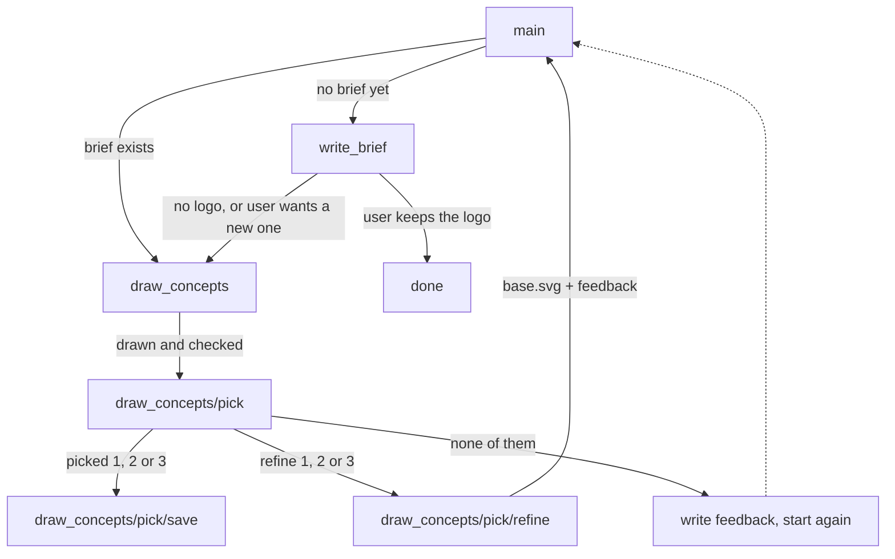

<p align="center"></p>

# logo-creation

A [Rein](https://rein-lang.com) program that creates a logo for a project. The agent writes a brief, draws three SVG concepts, and checks them with a script. The user picks one. The agent saves the logo files and adds the logo to the README.

This repo is also an example of a Rein program. It shows typed questions, a subagent hand-off, bundled scripts, and a retry without a cycle.

## Install

```sh
rein install -g "github:rein-lang/logo-creation#<commit sha>"
```

The scripts need `rsvg-convert` (librsvg), ImageMagick 7 (`magick`) and `xmllint`. On macOS:

```sh
brew install librsvg imagemagick
```

## Use

```sh
rein step logo-creation --input project=<path to the project>
```

## Graph



| File | Job |
| --- | --- |
| `main.rein` | Entry. Resumes from `.logo/brief.md` when an earlier run wrote it. |
| `write_brief.rein` | Reads the project and writes the brief. Asks before it replaces a logo. |
| `draw_concepts.rein` | A subagent draws three SVG concepts. `scripts/check-svg.sh` checks them. |
| `draw_concepts/pick.rein` | `scripts/preview.sh` renders the concepts. `scripts/mockup.sh` shows them in place. The user picks one or a refinement. |
| `draw_concepts/pick/save.rein` | `scripts/export.sh` saves the logo files to `assets/`. |
| `draw_concepts/pick/refine.rein` | Copies the picked concept to `.logo/base.svg`. The next round draws variations of it. |
| `scripts/mockup.sh` | Shows each concept as a round avatar, a site header and a favicon. |
| `scripts/test.sh` | Self-test for the scripts. |

## Output

The program writes these files to `<project>/assets/`:

- `logo.svg`
- `logo-16.png`, `logo-32.png`, `logo-48.png`, `logo-180.png`, `logo-192.png`, `logo-512.png`
- `favicon.ico` (16, 32 and 48 px)
- `logo-square.svg`, `logo-circle.svg`, `logo-mark.svg` (the logo set) and a 512 px PNG of each: `logo-square-512.png`, `logo-circle-512.png`, `logo-mark-512.png`

Work files go to `<project>/.logo/`. The program deletes that folder at the end.

## Patterns this program shows

- **Rules in code.** Typed answers (`boolean`, unions) pick the branch. The prompt text does not decide. See the `info.logo == "has a logo"` check in `write_brief.rein`.
- **Scripts, not inline commands.** Each shell step is a script in `scripts/`. A request names the script and its arguments. You can run and test each script by hand.
- **A script as a gate.** `check-svg.sh` checks each concept: a square `viewBox`, no `<text>`, no `<image>`, at most 3 colors, at most 8 KB. The agent runs it and answers `valid`. The process goes on only on yes.
- **Subagent hand-off.** `draw_concepts.rein` uses `delegate` to give the drawing to a subagent.
- **Retry without a cycle.** Rein has no loops. On "none of them", the agent writes the feedback to `.logo/feedback.md` and starts the program again. `main` finds the brief and goes to `draw_concepts`.
- **Refine, not restart.** The user can pick a concept to refine. The next round draws variations of `.logo/base.svg`.
- **Nested files.** A function with one caller lives in a folder named after the caller: `draw_concepts/pick.rein`, `draw_concepts/pick/save.rein`.
- **Names.** Each file except `main` is a snake_case imperative verb: `write_brief`, `draw_concepts`, `pick`, `save`. A function with one caller sits in a folder named after the caller. A function that only the entry calls stays at the root, such as `write_brief`. Parameters and answers are snake_case too. The rules are in [Naming](https://rein-lang.com/docs/reference/decisions#naming).

## Develop

Run `git config core.hooksPath .githooks` once. Each push then runs `rein check .` and `scripts/test.sh`. Both must pass, and `rein check .` must report 0 errors and 0 warnings.

## License

MIT
